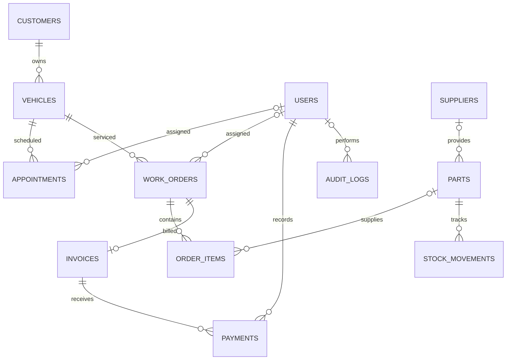
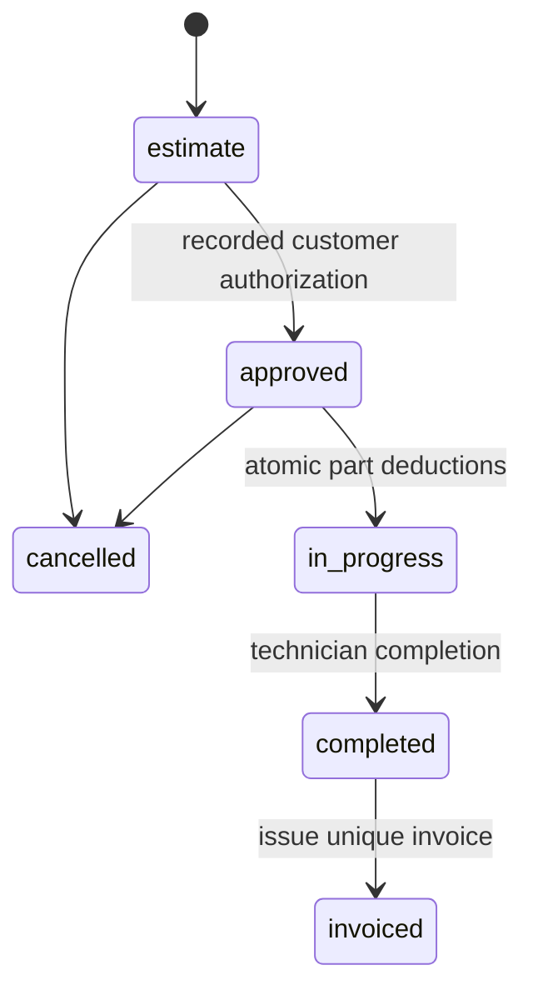

# Architecture and data model

## Stack and design

Laravel 12 supplies routing, validation, session authentication, CSRF middleware, password hashing, migrations, database transactions and the query builder. Blade escapes user-visible text. CSS and a small progressive JavaScript file serve directly from public/, so navigation does not download a client framework or require a separate API server. All core forms submit normally and validation is server-side. MySQL is the configured runtime database. SQLite is only the default fast automated-test database.

The installation represents one workshop/business. There is no multi-tenant boundary or branch isolation. Five roles are enforced by `App\Support\Access` at controller entry points. Technician work order access additionally checks assignment at record level. Query builder bindings are used for submitted values; user input cannot select arbitrary table/column names because generic resources are defined by an allowlist in `App\Support\Resources`.

## Components

| Component | Responsibility |
|---|---|
| AuthController | Login, identity/IP throttling, session regeneration, logout, password change |
| DashboardController | Bounded operational summaries scoped by role |
| ResourceController | Allowlisted customer/vehicle/appointment/part/service/supplier CRUD, history and stock adjustment |
| OrderController | Estimates, authorization, assignment, findings, controlled transitions and invoice creation |
| BillingController | Invoice listing/print data, payment validation and idempotent receipt recording |
| AdminController | Branding, logo processing, users, role changes, audit, reports and streamed CSV |
| SecurityHeaders | Inactive accounts, forced password changes, CSP and defensive headers |
| Workshop helper | Minor-unit conversion, order totals and audit event insertion |
| AppServiceProvider | Business identity shared with views and custom pagination |

## Relationships

`settings` is a singleton business record. Laravel also manages users, password reset tokens, sessions, jobs and cache tables. Reset-token and queue tables are scaffold infrastructure; no public reset-email or messaging workflow is implemented.

## Money and quantities

All monetary values persist as integer minor units (`*_cents`) using unsigned BIGINT. Supported currencies have two decimal places. Validated decimal input accepts up to two fractional digits. Line amounts are unit cents × integer quantity. Tax is subtotal × basis points / 10,000, rounded once to the nearest minor unit; invoice totals are calculated by the server. The client never supplies invoice totals, paid totals or stock balances.

Part and labor quantities are positive whole units. Fractional labor can be represented as one custom line with the final amount. Cost/price fields are capped at 1,000,000 currency units per unit, and line quantity at 1,000. Negative prices/payments and negative resulting stock are disallowed. No discounts or multiple tax classes are included. Currency changes are prevented after priced workshop records exist. New work orders snapshot the default tax rate; changing settings does not reprice old estimates.

## Lifecycle and concurrency

Mutations that affect multiple records use database transactions. Work order rows lock during item edits, approval, reassignment, progress and invoice creation. Starting repairs locks required part rows in ID order, validates the combined quantity per part, creates stock movement records and changes status as one transaction. Any shortage rolls back every deduction. Stock adjustments lock the part row and cannot make stock negative. Payments lock their invoice row, check the remaining balance and a unique idempotency key, insert the receipt, update paid totals and record audit together. Duplicate invoice creation is also protected by a unique work_order_id constraint. Database foreign keys preserve linked history.

Technician appointment writes lock the assigned user row, then test for overlapping active bookings. Cancelled, no-show and completed bookings do not reserve slots. This protects parallel bookings for a given technician on MySQL. Automated tests exercise sequential conflict cases and rollback behavior; high-load concurrency stress testing is not included.

## Historical records

Approved estimate items cannot change. Invoiced orders cannot change findings or assignment. An invoice stores subtotal, tax, total, paid amount and JSON snapshots of the business/customer at issue time; newly issued invoices also store vehicle identity inside the customer snapshot. Invoice lines remain in the locked order_items relation. Old logos remain on disk for invoice snapshot references. Payments and stock movements are append-only in the application. Audit logs are read-only through HTTP but not cryptographically tamper-proof against a database administrator.

## Performance

Directories and ledgers paginate (15–30 rows per page). Dashboard queries cap displayed jobs, appointments, stock warnings and activity. Lists use joins rather than per-row queries. Primary/foreign/unique keys and status/date indexes support normal workshop lookups. CSV exports stream in 500-row chunks. Catalog and selection dropdowns currently load their complete directory; switch those to paginated autocomplete if the business grows to very large catalogs/customer fleets. Search uses parameterized LIKE queries, and broad substring search may require full-text/search indexing at larger scale. No production capacity or latency guarantee is asserted.

## Extending the MVP

Add schema changes as new migrations, never edit already-deployed migrations. Add permissions in Access and enforce them server-side for new controllers. Add meaningful lifecycle and role tests for financial changes. New generic resource definitions must remain developer-controlled allowlists. Future credit notes/refunds should use explicit reversal ledgers rather than rewriting paid invoices. A public/mobile API should have separately reviewed authentication, scopes, validation and versioned contracts; the current routes are browser session endpoints.
